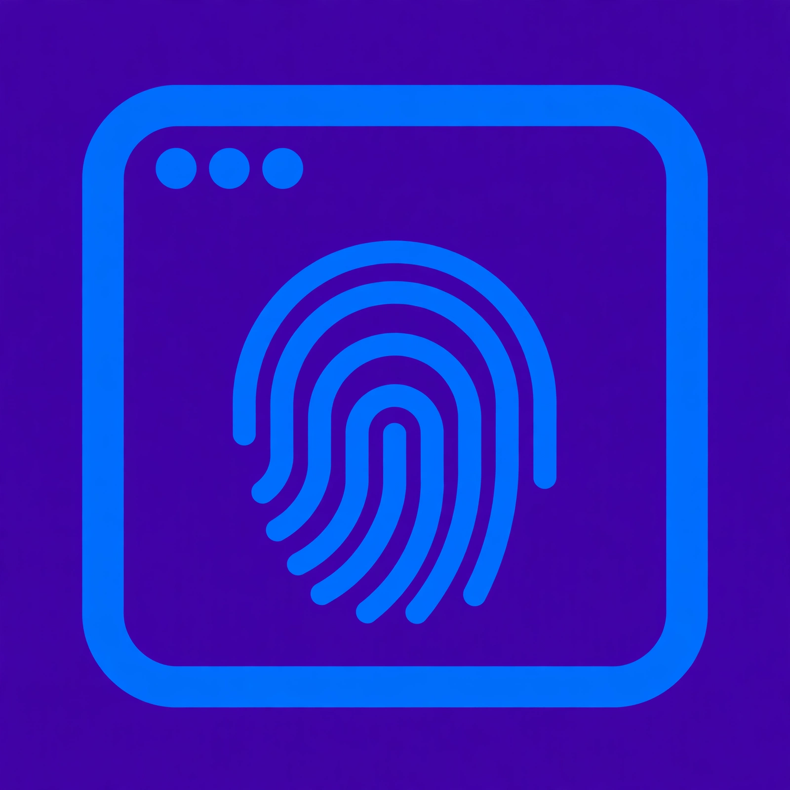
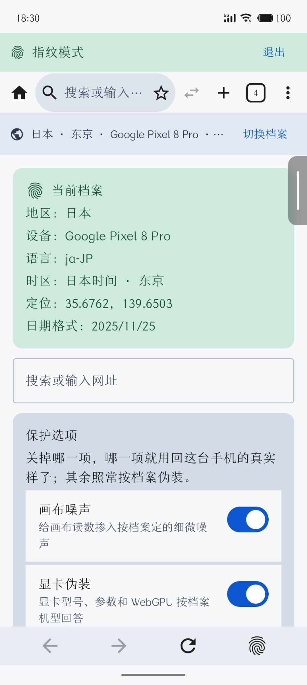

## TuxunBrowse

免费开源的 Android 指纹浏览器——双内核随便切，再带一套能换地区、换机型的指纹模式。

打开就是网页：没有信息流，没有推送，没有广告。普通浏览有火狐和系统 WebView 两个内核；想让网站看到另一台「手机」时，进指纹模式，地区、机型、语言、时区、定位、显卡参数整套换掉，还能按组合分开存登录、绑代理。

   
  

[下载最新版](https://github.com/liyuzhou79-star/TuxunBrowse/releases/latest) · 这是什么 · 快速上手 · 功能总览 · 指纹模式 · 已知限制 · 参与贡献

---



## 这是什么

TuxunBrowse 是一个完全开源（GPL-3.0）的 Android 浏览器，和大多数浏览器不同的地方有两点：

- **双内核**：火狐 GeckoView 和系统 WebView 都装在同一个 App 里。首次打开时你自己选主内核，之后随时能改；某个网站在火狐下显示不对，点地址栏的按钮就能把当前标签切到 WebView（兼容模式），还能记住这个网站以后自动这样打开。无痕浏览可以单独选一个内核，和主内核分开记。两个内核的登录状态不互通。
- **指纹模式**：一套单独的简洁界面，按「地区 × 机型」档案浏览网页。美国、日本、新加坡、台湾地区四份预制档案，设备型号、语言、时区、定位坐标、屏幕参数、日期格式、语音列表、字体清单、网络信息、显卡参数互相对齐——不是只改一个 UA 了事，而是整套参数讲同一个故事。每个组合的 Cookie 和网站数据单独存放、可以绑自己的代理，常用组合能存成「我的档案」，还能导出成文件换设备用。

普通浏览该有的也都有：多标签、广告拦截、下载管理、书签文件夹、历史分组、备份恢复、无痕浏览、阅读模式，一样不少。所有安装包都由 GitHub Actions 公开构建，代码全开源。

## 快速上手

第一次用，三步就够：

1. 在下方「下载」里拿最新版安装包，装好打开。
2. 第一屏选一个主内核（火狐或系统 WebView），之后在设置里随时能改。
3. 直接输入网址或搜索就能上网；想试指纹模式，点地址栏里的切换内核按钮，选「指纹模式」，挑一个地区档案就进去了。

## 下载

到 [Releases](https://github.com/liyuzhou79-star/TuxunBrowse/releases) 打开最新发布页下载。当前最新版：[v0.219.0](https://github.com/liyuzhou79-star/TuxunBrowse/releases/tag/v0.219.0)（预发布）。

| 文件 | 包名 | 适合 |
| --- | --- | --- |
| `TuxunBrowse-v<版本>-test.apk` | `com.tuxunbrowse.android` | 64 位机型，最低 Android 8.0 |

说明三点，免得用着糊涂：

- 现在发布的是**测试包**，用一把固定的测试签名签署，版本之间可以直接覆盖安装；正式签名方案还没定下来，定下来会在这里写明。
- 安装包约 187 MB，其中绝大部分是火狐内核（GeckoView）本身；体积路线（例如内核按需下载）还没有定。
- App 内有手动检查更新（设置里点一下才联网，不自动检查、不后台轮询），有新版会写明版本号并给出下载页入口。

## 功能总览

### 双内核与选核

- **火狐内核（GeckoView）**：自带内核级反跟踪，Cookie 独立存放，不随系统版本变化。
- **系统 WebView**：兼容性好，内核随系统更新。
- 按站兼容模式：某个网站在火狐下坏掉，切到 WebView 打开并可记住这个网站；兼容名单在设置里管理（无痕标签里不会写入名单）。
- 设置里有一张「两个内核的差别」说明卡，逐条写清哪些功能只有哪个内核有，不藏着掖着。

### 自家首页

首页是应用自己做的页面，不拿任何网站的页面当首页：

- 大搜索框，搜索引擎可以快速切换（百度 / 必应 / Google / DuckDuckGo）
- 常用书签快捷入口（有书签时才显示，置顶的书签排在前面）

### 浏览

- 多标签页：每个标签标明自己用的内核；支持标签搜索、最近关闭列表（普通标签关掉后可从这里找回）、关闭其他 / 关闭全部、误关恢复；长按一张标签卡片还有菜单；标签列表可以多选，一次关闭多个或批量加入书签；关掉应用再打开可恢复上次的普通标签。标签开得太多时，最久没用的后台标签的内核会自动休眠省内存（同时最多留 6 个）
- 地址栏网址 / 搜索二合一：平时只显示域名，点进去才显示完整网址；输入时只联想书签，不翻你的历史
- 下拉刷新、边缘手势返回 / 前进、页内查找（两个内核都带找到的个数）、桌面版网站切换（按站记住）
- 长按网页里的链接或图片会弹出菜单：后台新标签打开、复制、分享，图片还能保存
- 阅读模式（系统 WebView 标签）：把正文重新排成干净的单栏，字号四档、背景四档可调
- 网页打不开时显示自家错误页，按原因写清是怎么回事，可以一键重新加载、回首页或换另一个内核打开；断网打不开的，网络恢复后会自动重新加载一次
- 全屏视频、网页文件上传、网页要相机 / 麦克风时走系统权限弹窗，都齐了
- 网站信息页：看连接是否安全、证书是谁签的、本页拦了多少，也能在这里切换本站兼容模式或清除本站数据
- 打印 / 存为 PDF、网页截图（两个内核都支持；火狐由内核先生成 PDF 再交给系统打印）、用其他浏览器打开当前页、把当前网页添加到主屏幕

### 广告拦截

- 系统 WebView 按内置名单（318 个广告 / 跟踪专用域名，正常网站的域名不在名单里）拦截，还可以隐藏页面上的广告位
- 火狐内核用自带的反跟踪拦截，本页拦了几个同样能在网站信息页看到数字（两个内核计数口径不同：一个按名单命中、一个按内核反跟踪事件）
- 内置净化脚本（仅系统 WebView 标签）：在网页打开前运行，清理广告、拦截恶意跳转和跟踪指纹；火狐标签用内核自带的反跟踪。设置里只有一个总开关，默认开，无痕标签不注入
- 设置里能看双内核的累计拦截数，清零会先让你确认（无痕浏览不往累计里加）

### 下载

- 下载请求会带上当前页面的登录状态、浏览器标识和来源页地址，需要登录或来源校验的文件也能正常下成
- 下载方式二选一：系统下载 / TuxunDown（多线程下载器，需另行安装，没装时自动改用系统下载）
- 下载列表按进行中 / 已完成 / 失败筛选，失败会写清原因（大白话），可以重试、删除、按文件名搜索；指纹模式下的下载会标明来自哪个档案组合，重试时按原组合的登录状态重试，不串普通模式的登录
- 资源嗅探（系统 WebView 标签）：列出当前页面里的文件、图片和音视频链接，可单个或批量下载
- 火狐标签的下载由浏览器直接保存到下载文件夹，进度在下载页单独一节显示，可以随时取消

### 数据

- 书签：添加、改名、置顶、搜索、批量删除、文件夹分类；导出可选本应用 JSON（信息最全）或通用 HTML（其他浏览器可直接导入）；导入两种都支持
- 历史记录：按今天 / 昨天 / 更早分组，可搜索、单条删除、按时间范围清除，保留期限可选永久 / 30 天 / 7 天
- 备份与恢复：一份文件备份全部书签（含文件夹）、历史、按站兼容名单、桌面版站点名单、广告拦截累计数和全部设置，换手机或重装后导入即可合并回来
- 系统自动备份是关着的：历史、书签、指纹档案这些不会跟着系统云备份或换机迁移离开手机，要带走请用 App 内的导出
- 诊断信息：长按设置 → 关于页顶部的品牌区才会显示，只有版本号和数字，可一键复制，没有任何网址和浏览内容

### 隐私与安全

- 增强跟踪保护（两档）：标准档拦截常见广告与跟踪；严格档多拦指纹追踪、挖矿脚本和更多跟踪域名
- 不要追踪（DNT，只对系统 WebView 有效）、不出售或分享资料（GPC，两个内核都支持）、停用 WebRTC（只对系统 WebView 有效）都可按需开
- 无痕浏览：不记历史、不保存标签、不进最近关闭列表，标签列表和系统最近任务里都不显示无痕页面的预览图。火狐无痕是真隔离；系统 WebView 的无痕标签全部关掉后，会清掉系统 WebView 的全部 Cookie，普通标签也会跟着退出登录（系统 WebView 只有一个 Cookie 罐，分不开），打开无痕时弹窗会先讲清这一点
- 无痕里拦下的请求不进广告拦截累计，无痕里切内核也不会把网站写进普通模式的兼容名单
- HTTPS 优先（默认开）：http 网址自动改用 https 打开，本机和局域网地址不改；网站只支持 http 时错误页上可以只对这一次改回去
- 网站要登录（基础认证）时弹自家登录框，账号密码只发给该网站、不保存；证书有问题时先弹窗讲清风险，点「仍然继续」只对这一次生效
- 从别的 App 递进来的链接、导入文件里的链接，只认 http / https 开头的，其他一律拦下并给出提示
- 系统 WebView 的安全开关已明确设为稳妥值：网页不能访问手机本地文件，安全网页里混入的不安全内容一律拦截，安全浏览保持开启

## 指纹模式

指纹模式是这个浏览器的主打功能，单独说清它能做什么、不能做什么。

### 能做到

- **四份预制档案**：美国、日本、新加坡、台湾地区；每份档案的机型、语言、时区、定位、屏幕、日期格式、语音列表、字体清单、网络信息、显卡与 WebGPU 参数互相对齐
- **时区自选**：时区可以展开选（美国有东部 / 中部 / 山地 / 太平洋四个），定位和日期格式跟着时区走；时间不只是偏移对，网页读到的本地时间、日期字符串、时区名都按档案回答
- **机型可换、不许自相矛盾**：在该地区的机型库里换机型，显卡、屏幕、UA 会跟着一起换；语言只能在该地区合理的语言里选；常用组合存成「我的档案」（最多 200 条），可以导出成文件、从文件导入
- **逐组合隔离**：每个「地区 × 机型」组合的 Cookie 和网站数据单独存放，不同组合互不相通、与普通模式也分开；切回原来的组合，登录还在（不支持多档案存储的老 WebView 上会回落成共用，模式首页会如实标注）
- **逐组合代理**：每个组合可以绑自己的代理（HTTP / HTTPS / SOCKS5），进模式时生效、退出时断开、切换组合自动换用（这期间普通 WebView 标签也会走它，火狐标签不受影响，代理卡上写明）
- **出口 IP 自查**：模式首页手动点一下，查当前网络的出口 IP 在哪个国家、哪个时区，和档案当场对账
- **指纹自查**：模式首页内置自查页，二十多项探针在本地跑，逐项给出通过 / 异常 / 无法检测，不往外发数据
- **八项保护开关**：画布噪声、显卡伪装、音频噪声、字体清单、WebRTC 中转形态、传感器、电池、Chrome 对象，逐项可关，关掉哪项哪项就用回真机
- 模式有专属界面：顶栏配色、档案信息常显条；标签不记历史；关掉应用再打开，指纹标签组还在（不会自动进入模式，要自己点进来）

### 工作方式

指纹模式只用系统 WebView：火狐内核没有逐标签的指纹设置通路，硬做只能换个 UA，那不叫指纹模式。伪装参数按档案种子固定生成，同一个档案每次打开读数一致，不会今天一个样明天一个样。

## 已知限制

如实写，不藏着——这些是当前技术路线（在系统 WebView 上做 JS 层伪装、不改内核）绕不过去的：

- **语言请求头改不了**：网页请求头里的语言顺序仍是真机语言，检测站会因此扣分（BrowserScan 的「语言不符」就是这一项）
- **深检测仍能认出动过手脚**：Canvas、WebGL、Audio 三面做了种子噪声和参数对齐，参数面自洽，但 BrowserScan 这类深检测仍会各扣 5 分报「似乎被人为修改」——回放真机标准读数需要逐机型的真实数据集，公开渠道没有，我们不编造数值硬凑
- **字体本体换不掉**：字体清单的答复和字体量测已经跟档案走，但字形渲染用的还是真机字体文件
- **窗口尺寸是真机的**：页面能看到的窗口宽高由真机窗口决定，改了会和布局打架，只记档不动
- **请求头会带出包名**：系统 WebView 独有的 X-Requested-With 头会把应用包名告诉网站，没有关闭通路，危险度中低，模式首页有如实说明
- **IP 归属地由你的网络决定**：档案只管浏览器这一侧，出口 IP 在哪个国家取决于你用的网络，模式首页的 IP 自查就是帮你对这一项账的
- **体积大**：安装包约 187 MB，绝大部分是火狐内核本身

与同类指纹浏览器（Octo、GoLogin 及开源方案）的逐项对标见 [docs/FINGERPRINT_BENCHMARK.md](docs/FINGERPRINT_BENCHMARK.md)，缺什么、为什么缺都写在那里。

## 更新记录

每个版本的详细说明见对应的 [Release 页面](https://github.com/liyuzhou79-star/TuxunBrowse/releases)。

## 从源码编译

```bash
git clone https://github.com/liyuzhou79-star/TuxunBrowse.git
cd TuxunBrowse
./gradlew --no-daemon app:assembleDebug
```

需要 JDK 17 与 Android SDK 35。本仓库的每个版本也都由 GitHub Actions 自动编译，发布页的安装包就是这么来的。

## 参与贡献

欢迎 issue 与 PR：报问题时请写清用的内核（火狐 / 系统 WebView / 指纹模式）、网址和复现步骤，方便定位。

## 贡献者

- [liyuzhou79-star](https://github.com/liyuzhou79-star)
- museai

## 致谢

- [GeckoView](https://mozilla.github.io/geckoview/)（Mozilla）— 火狐内核，MPL-2.0
- 系统 WebView / Chromium — 系统内核
- 指纹模式的设计参考了 Camoufox、Apify fingerprint-suite、fingerprint-chromium、Brave farbling 等开源项目的公开思路与数据口径，只借鉴思路、实现为本项目原创代码，出处与许可见 [THIRD_PARTY_NOTICES.md](THIRD_PARTY_NOTICES.md)
- 所有试用并回报问题的使用者

## 许可证

GPL-3.0。GeckoView 为 MPL-2.0 许可，与 GPLv3 分发兼容，细则见 [THIRD_PARTY_NOTICES.md](THIRD_PARTY_NOTICES.md)。本项目仅供学习与个人使用，请遵守所在地法律法规。
